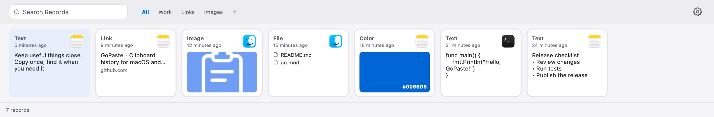
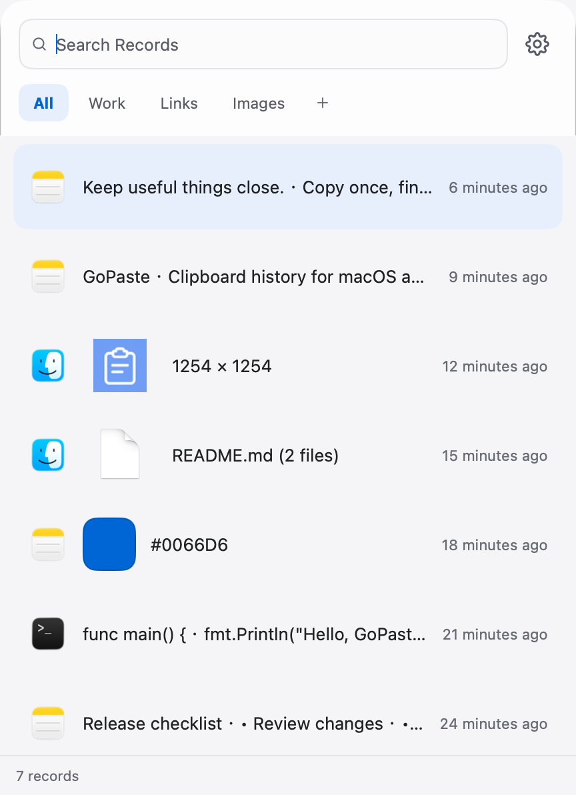
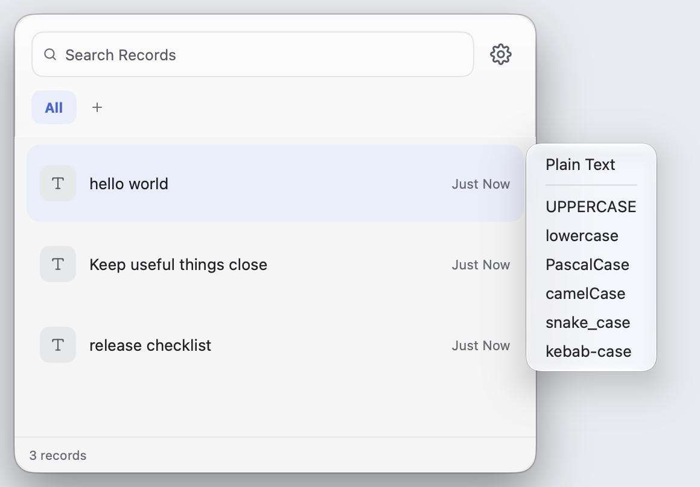
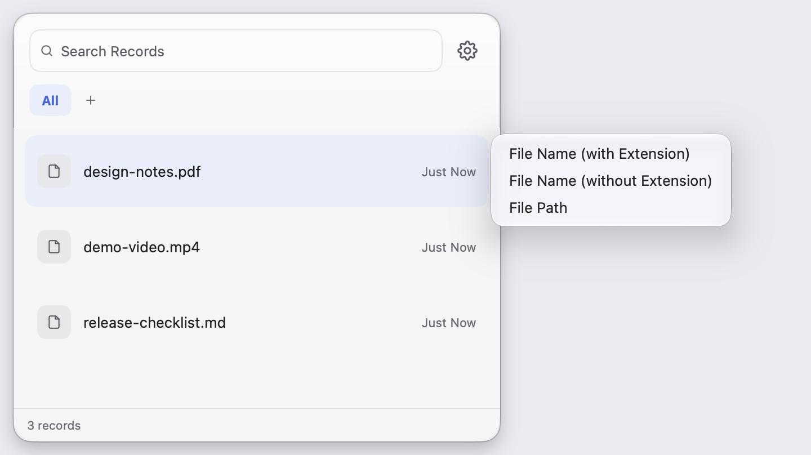

# GoPaste

English | [简体中文](README.zh-CN.md)

A clipboard manager for macOS and Windows, built with Go and [MyGo](https://github.com/egoist/mygo).

**Bottom bar · Classic theme**



**Pointer panel · Transparent theme**



**Paste As · Text conversions**



**Paste As · File information**



[See more theme and settings screenshots](docs/screenshots.md)

## Features

- Keep a history of copied text, images, links, colors and files, with the source app and copy time
- Search your history, organize items in regular lists, or filter them with smart lists
- Preview and drag items, and paste with formatting or as plain text
- Choose formats for each record type: text case and naming conversions, Markdown, file names and paths, and HEX / RGB / HSL colors
- Limit history by record count, storage size and retention time; records in regular lists are exempt from these limits
- Choose which apps to exclude, and skip blank text, content marked confidential or images above a size limit
- Use a resizable bottom bar or a panel that opens beside the cursor
- Choose Classic or Transparent, both following the system's light or dark appearance, in English or Simplified Chinese

## Privacy

- **No telemetry**: no usage analytics, behavioral data collection or tracking
- **Local storage**: clipboard history and images stay on your device; clipboard content is not uploaded to the developer
- **Transparent network access**: enabling link previews contacts the linked website and preview image hosts; update checks and downloads connect to GitHub or your configured mirror

## MyGo

GoPaste uses [MyGo](https://github.com/egoist/mygo)'s native UI:

- GPU-rendered UI written in Go, with no WebView, HTML or JavaScript
- No cgo required; the same codebase cross-compiles to macOS and Windows
- Desktop APIs for the clipboard, tray, global shortcuts, drag and drop, and signed updates
- UI tests and screenshot rendering that run without opening a window

## Historical memory measurements

These measurements describe an earlier development build and have not been repeated for the current version.

Measured on October 23, 2026 with a local arm64 development build on macOS 27.0.1, Apple M1 Pro and 32 GB RAM.

The test used 2,000 records: 800 text, 500 image, 400 file, 200 link and 100 color records. Samples included 4K images, roughly 1 MiB of text in one record and 600 files in another.

| Scenario | Memory usage |
| --- | --- |
| History loaded | 46.2 MiB |
| Panel open | 68.1 MiB |
| Scrolled to record 2,000 | 183.8 MiB |
| Bottom bar resized repeatedly | 171.5 MiB |
| Panel hidden after testing | 104.8 MiB |
| Peak during each run | 202.1 MiB |

Values are medians of three runs, using the Physical footprint metric from `vmmap -summary` after three seconds idle at each stage, without forcing garbage collection.

The test covered storage and UI in a native window, without clipboard monitoring, the tray or the updater. Windows has not been measured yet.

## Install and use

Download from [Releases](https://github.com/viewhang/GoPaste/releases):

- macOS: choose Apple Silicon (arm64) or Intel (x64), extract the archive and move `GoPaste.app` to Applications
- Windows: run the x64 Setup installer

Press `Command+Shift+V` on macOS or `Ctrl+Shift+V` on Windows to show or hide the panel. Panel layout, shortcuts and exclusion rules are configurable in Settings.

On macOS, automatic paste requires permission in **System Settings → Privacy & Security → Accessibility**.

Settings has five pages: General, Keyboard Shortcuts, Exclusion Rules, Advanced and About. General contains history limits and the copy sound; Advanced contains paste behavior and data management; About contains the update mirror and automatic updates.

Select a record and press `Shift+Enter`, or choose **Paste As** from its context menu, to paste in a format supported by that record type. Markdown for images references local files.

| Shortcut | Action |
| --- | --- |
| `⌘⇧V` / `Ctrl+Shift+V` | Show or hide the panel |
| `↑` `↓` | Select a record; use `←` `→` in the bottom bar |
| `⌘[` / `Ctrl+[` | Previous list |
| `⌘]` / `Ctrl+]` | Next list |
| `Enter` / `Shift+Enter` | Paste / open Paste As (↑↓ to select, Enter to paste) |
| `⌘1–0` / `Ctrl+1–0` | Paste a visible item, up to ten items |
| `Space` | Preview |
| `⌘F` / `Ctrl+F` | Search |
| `⌘,` / `Ctrl+,` | Open Settings |
| `Backspace` | Delete the selected record |
| `Esc` | Close the preview, clear search or hide the panel |

Hold Command on macOS or Ctrl on Windows to show quick-paste numbers. Check for updates and configure automatic checks or installation in **Settings → About**.

## Development

Requires Go 1.27.3.

```bash
CGO_ENABLED=0 go run .
CGO_ENABLED=0 go test ./...
```

UI translations are in `internal/locales/`. After editing them, run:

```bash
go tool mygo generate
go tool mygo i18n check
```

## Build and release

```bash
# macOS Apple Silicon
go run ./tools/package -arch arm64 -o build/darwin-arm64 -release

# macOS Intel x64
go run ./tools/package -arch amd64 -o build/darwin-amd64 -release

# Windows x64
go tool mygo build -platform windows/amd64 -o build
```

Binaries, installers and update files are written to `build/<platform>-<architecture>/`.

Local macOS builds require `macos.signingIdentity` in `mygo.json`. Update archives also require `updates.privateKey` or `MYGO_UPDATER_PRIVATE_KEY`.

Official releases use the [Release workflow](.github/workflows/release.yml). Update `version` in `mygo.json`, commit it, then push the matching tag. Replace `<version>` below with the committed version:

```bash
git tag -a "v<version>" -m "GoPaste v<version>"
git push origin main "v<version>"
```

The workflow tests and builds macOS arm64, macOS amd64 and Windows amd64, creates the GitHub Release, and uploads application archives, the Windows installer, update manifests and delta updates.

The repository needs three Actions secrets: `MACOS_CERTIFICATE_P12`, `MACOS_CERTIFICATE_PASSWORD` and `MYGO_UPDATER_PRIVATE_KEY`. macOS packages use a local signing certificate and are not notarized by Apple.
