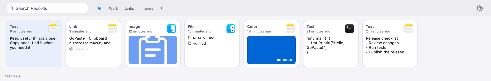
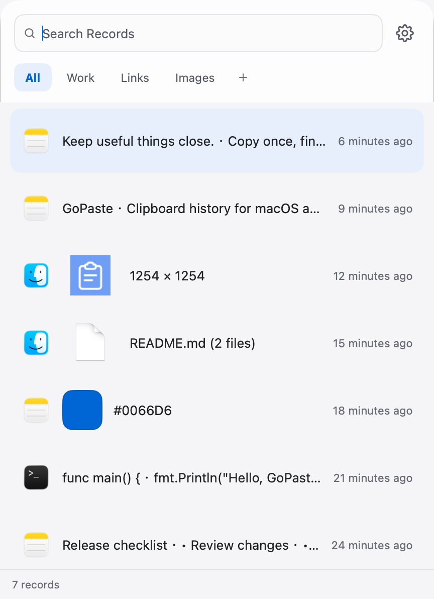
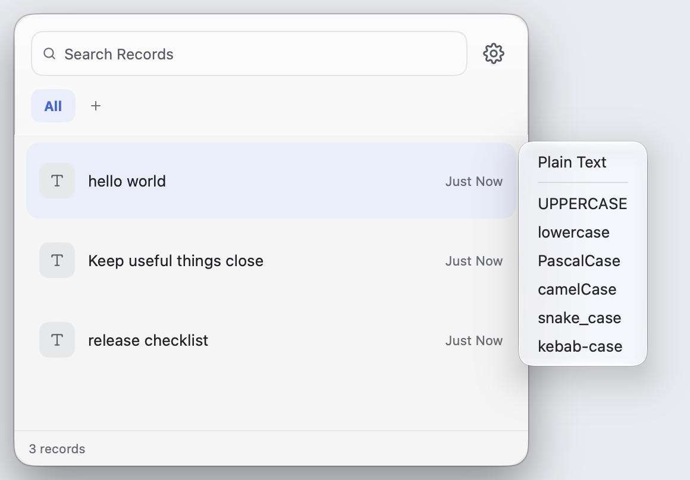
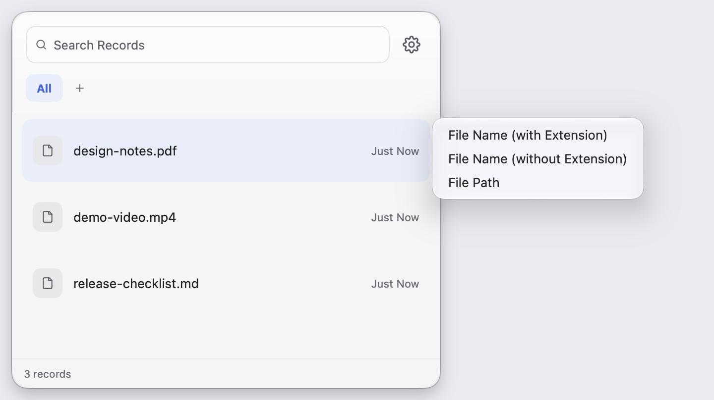

# GoPaste

[English](README.md) | 简体中文

macOS 和 Windows 剪贴板管理器，使用 Go 和 [MyGo](https://github.com/egoist/mygo) 开发。

**贴底长条 · 经典主题**



**跟随鼠标面板 · 透明主题**



**粘贴为 · 文本转换**



**粘贴为 · 文件信息**



[查看更多主题与设置截图](docs/screenshots.md)

## 功能

- 记录复制过的文本、图片、链接、颜色和文件，保留来源应用和复制时间
- 搜索历史记录，用普通列表整理内容，或用智能列表按规则筛选
- 预览、拖拽记录，粘贴时可保留原格式或转为纯文本
- 按记录类型选择粘贴格式：文本大小写与命名转换、Markdown、文件名与路径，以及 HEX / RGB / HSL 颜色
- 按条数、存储容量与保存时间限制历史记录，普通列表中的记录不受这些限制
- 自选不记录的应用，也可排除空白内容、带机密标记的内容和过大的图片
- 面板可贴在屏幕底部，或在鼠标旁弹出，大小可调
- 经典和透明两种主题，均跟随系统深浅色，可切换中英文

## 隐私

- **无遥测**：不采集使用统计或行为数据，不做埋点追踪
- **本地存储**：剪贴板历史和图片仅保存在本机，不向开发者上传剪贴板内容
- **联网行为透明**：启用链接预览时会访问对应网站及预览图片地址；检查和下载更新时会连接 GitHub 或你配置的镜像

## MyGo

本项目使用 [MyGo](https://github.com/egoist/mygo) 的原生界面：

- Go 编写的 GPU 渲染界面，无需 WebView、HTML 或 JavaScript
- macOS 和 Windows 共用原生界面代码，加密存储通过 cgo 接入 SQLCipher
- 提供剪贴板、托盘、全局快捷键、拖拽和签名更新等桌面接口
- 界面可直接测试和渲染为截图，无需打开窗口

## 历史内存测量

以下为历史开发构建的测量结果，未按当前版本重新测试。

2026-10-23 使用本地开发构建（arm64）实测，环境为 macOS 27.0.1、Apple M1 Pro、32 GB 内存。

测试使用 2000 条记录：800 条文本、500 条图片、400 条文件、200 条链接和 100 条颜色，包含 4K 图片、单条约 1 MiB 的长文本和单条 600 个文件。

| 场景 | 内存占用 |
| --- | --- |
| 历史加载完成 | 46.2 MiB |
| 打开面板 | 68.1 MiB |
| 滚动至第 2000 条 | 183.8 MiB |
| 贴边连续缩放 | 171.5 MiB |
| 测试后隐藏面板 | 104.8 MiB |
| 每轮运行的峰值 | 202.1 MiB |

数据为三轮测试的中位数。每个阶段空闲 3 秒后使用 `vmmap -summary` 的 Physical footprint 指标采样，不强制触发垃圾回收。

测试通过原生窗口运行存储与界面代码，未启动剪贴板监听、托盘和更新器。Windows 尚未实测。

## 安装与使用

在 [Releases](https://github.com/viewhang/GoPaste/releases) 下载：

- macOS：打开对应架构（Apple Silicon 或 Intel）的 `.dmg`，将 `GoPaste.app` 拖入 Applications
- Windows：运行 x64 Setup 安装包

默认按 `Command+Shift+V`（Windows 为 `Ctrl+Shift+V`）呼出或收起面板。面板形态、快捷键和排除规则可在设置中修改。

macOS 自动粘贴需要在「系统设置 → 隐私与安全性 → 辅助功能」中授权 GoPaste。

设置分为通用、快捷键、排除规则、高级和关于。历史限制与复制提示音位于通用，粘贴行为与数据管理位于高级，更新镜像与自动更新位于关于。

选中记录后按 `Shift+Enter`，或在右键菜单中选择「粘贴为」，可按记录类型转换后粘贴。剪贴板图片选择「文件路径」或 Markdown 时，会提示选择导出位置，然后粘贴该文件的路径或链接。

| 快捷键 | 操作 |
| --- | --- |
| `⌘⇧V` / `Ctrl+Shift+V` | 呼出或收起面板 |
| `↑` `↓` | 选择记录，贴边模式使用 `←` `→` |
| `⌘[` / `Ctrl+[` | 上一个列表 |
| `⌘]` / `Ctrl+]` | 下一个列表 |
| `Enter` / `Shift+Enter` | 粘贴 / 打开粘贴为（↑↓ 选择，Enter 粘贴） |
| `⌘1–0` / `Ctrl+1–0` | 粘贴当前可见项目，最多十项 |
| `Space` | 预览 |
| `⌘F` / `Ctrl+F` | 搜索 |
| `⌘,` / `Ctrl+,` | 打开设置 |
| `Backspace` | 删除选中记录 |
| `Esc` | 关闭预览、清空搜索或收起面板 |

按住 Command（Windows 为 Ctrl）时显示快速粘贴编号。设置 → 关于中可检查更新、开启自动检查或自动下载安装。

## 历史加密

GoPaste 使用 SQLCipher 加密历史、搜索索引和设置，使用 AES-256-GCM 加密图片、预览和应用图标。首次启动自动生成密钥并存入 macOS 钥匙串或 Windows 凭据管理器，无需设置密码，系统可能提示授权。升级时会自动迁移旧历史。恢复备份需要同时保留数据目录和对应的系统凭据。系统剪贴板和主动导出的文件仍可供接收方读取。

## 开发

请在目标系统和架构上使用 Go 1.27.3 构建。macOS 支持 13 及以上，编译需要 Xcode 命令行工具。Windows 在 MSYS2 UCRT64 终端中安装 `mingw-w64-ucrt-x86_64-{gcc,openssl,pkgconf}` 后构建。脚本会静态链接 OpenSSL。

```bash
tools/with-sqlcipher go run .
tools/with-sqlcipher go test ./...
```

界面文案位于 `internal/locales/`，修改后运行：

```bash
go tool mygo generate
go tool mygo i18n check
```

## 打包与发布

```bash
# macOS Apple Silicon
tools/with-sqlcipher go tool mygo build -platform darwin/arm64 -o build

# macOS Intel x64
tools/with-sqlcipher go tool mygo build -platform darwin/amd64 -o build

# Windows x64
tools/with-sqlcipher go tool mygo build -platform windows/amd64 -o build
```

各平台的程序、安装包和更新文件输出到对应的 `build/<平台>-<架构>/` 目录。

在 Mac 上运行上述命令会使用项目配置的本地证书生成 DMG。没有该证书时，自用或小范围分享可加 `-sign -` 使用临时签名，例如 `tools/with-sqlcipher go tool mygo build -sign -` 会构建当前 Mac 架构的 DMG。生成签名更新包时，通过 `MYGO_UPDATER_PRIVATE_KEY` 提供 MyGo 更新私钥，也可在本地配置 `updates.privateKey` 指向密钥文件。

正式发布使用 [Release 工作流](.github/workflows/release.yml)：修改 `mygo.json` 的 `version` 并提交，再推送对应标签。将下面的 `<版本号>` 替换为已提交的版本号：

```bash
git tag -a "v<版本号>" -m "GoPaste v<版本号>"
git push origin main "v<版本号>"
```

工作流会测试并构建 macOS arm64、macOS amd64 和 Windows amd64，自动创建 GitHub Release，上传 macOS DMG、Windows 安装包、更新归档和清单。当有可用旧版本且增量包小于完整归档时，MyGo 还会生成增量更新文件。

仓库需要配置 `MACOS_CERTIFICATE_P12`、`MACOS_CERTIFICATE_PASSWORD` 和 `MYGO_UPDATER_PRIVATE_KEY` 三项 Actions secrets。macOS 发布包使用本地证书签名，未经过 Apple 公证。
