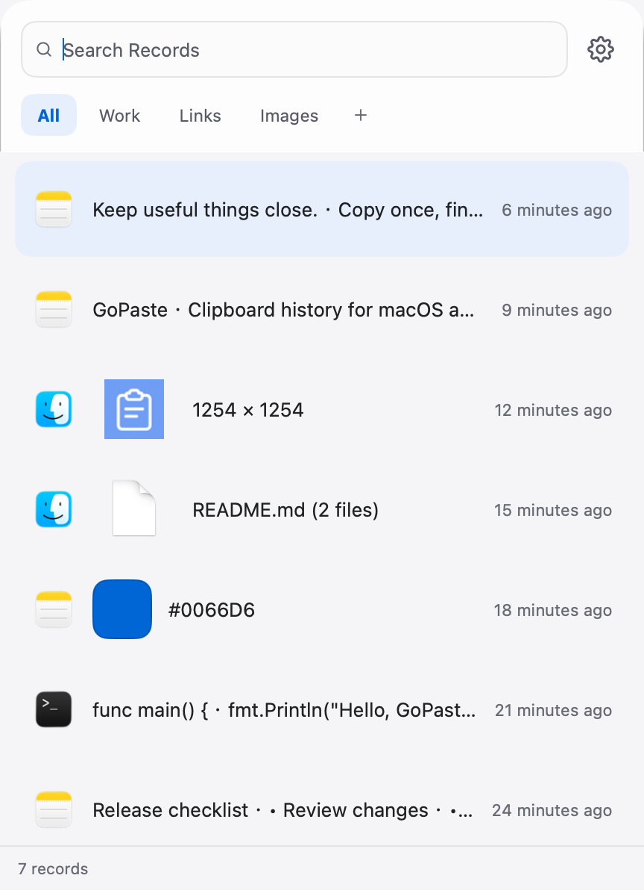
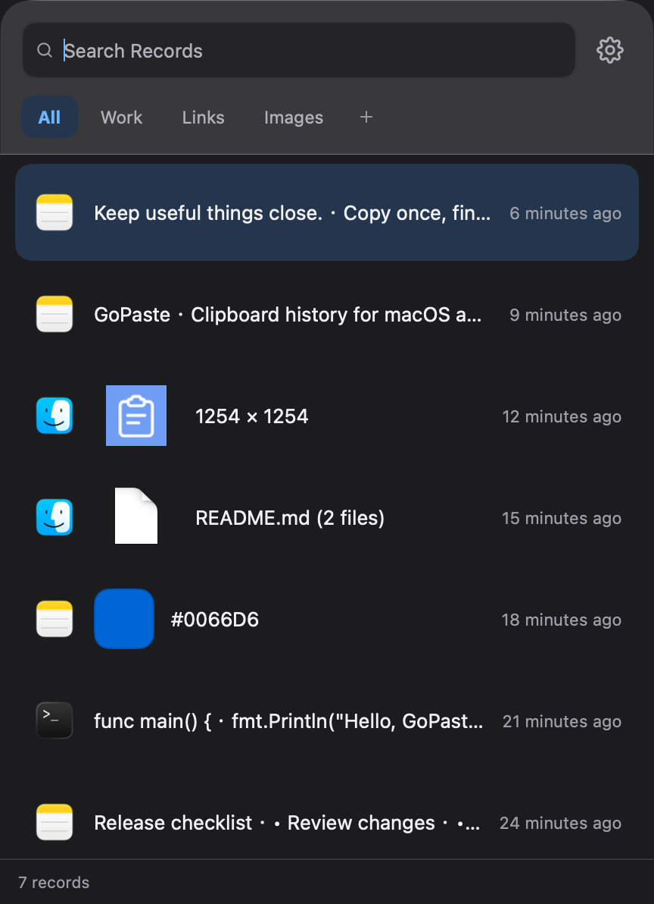
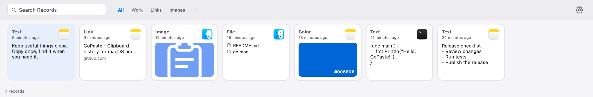
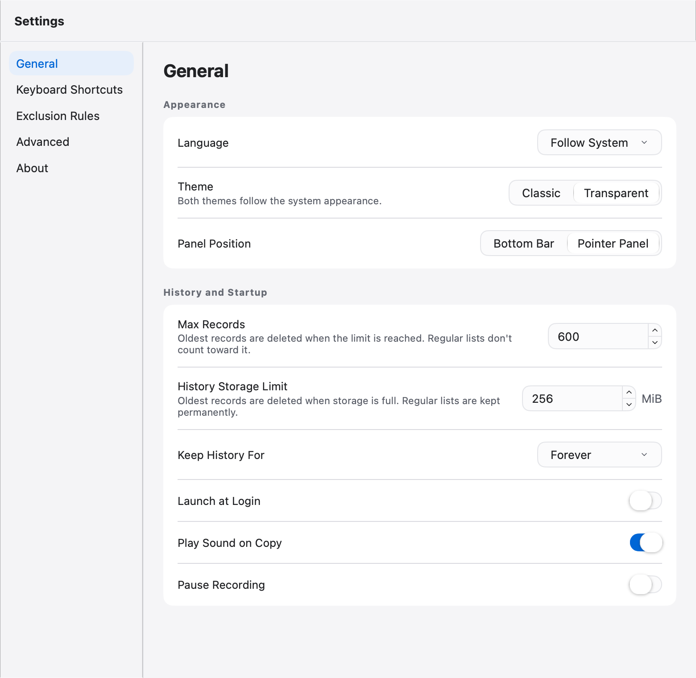
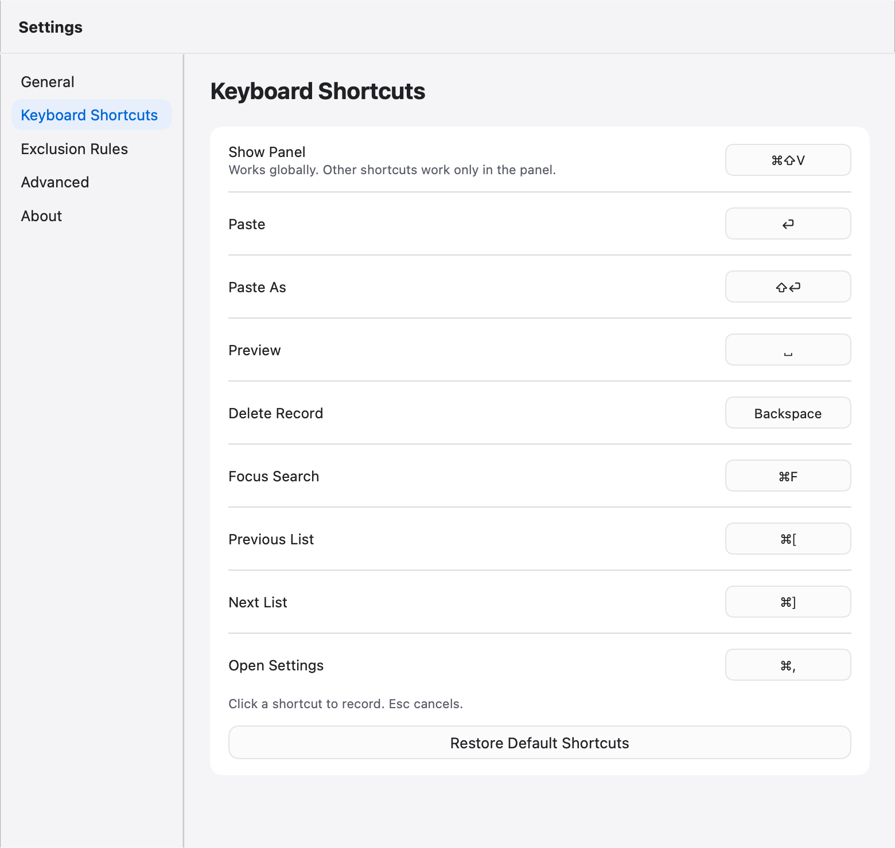
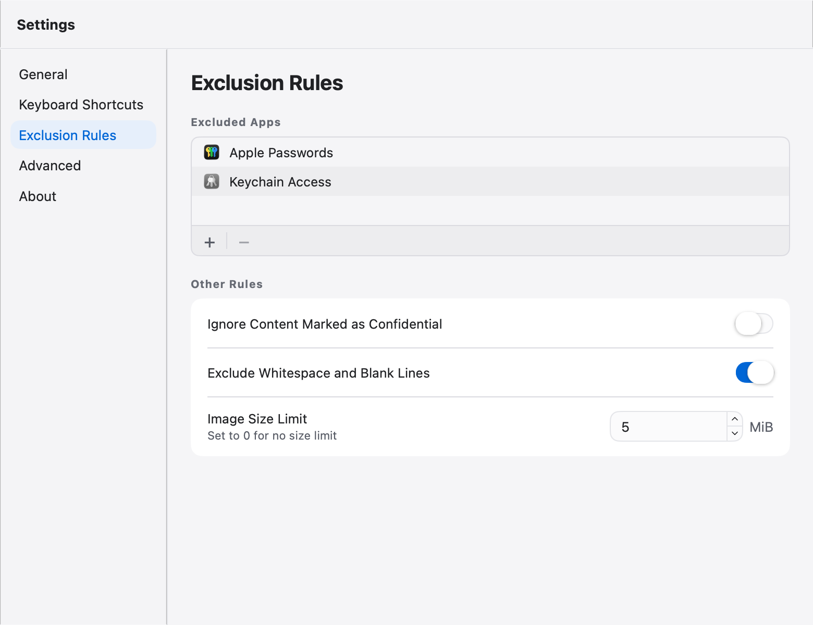
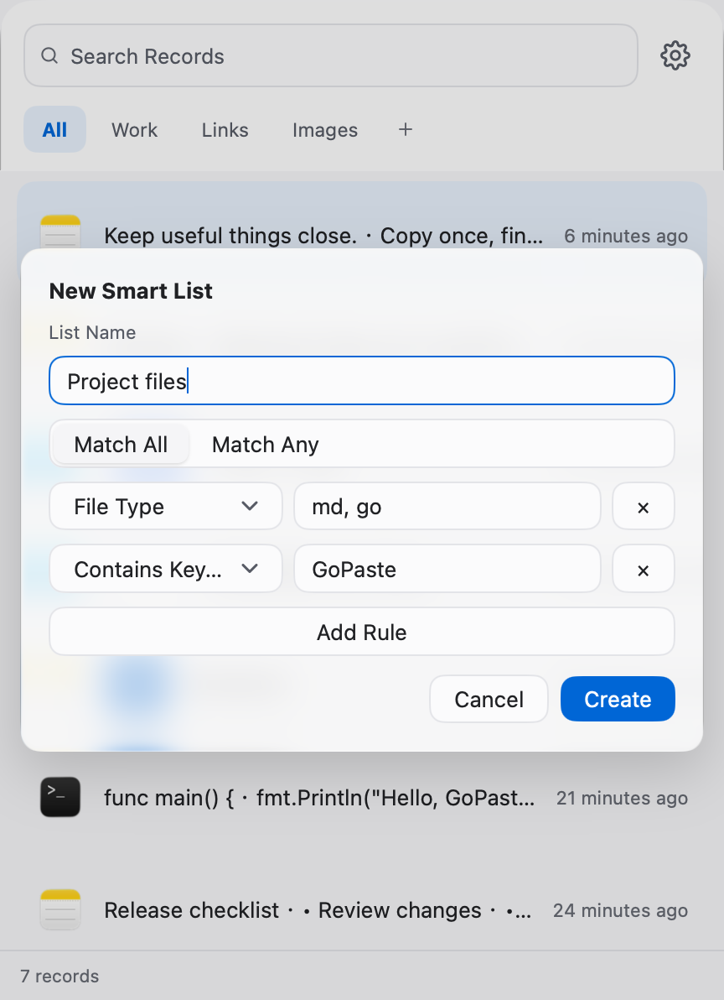

# Screenshots / 界面截图

GoPaste v0.1.6 · MyGo v0.7.4 · 2026-11-02

[English README](../README.md) · [简体中文 README](../README.zh-CN.md)

Rendered from the current native UI with English sample records at 2× scale. Window decorations and desktop backgrounds are omitted; transparency varies with the background.

使用当前原生界面和英文示例记录以 2 倍像素密度渲染，省略系统窗口装饰与桌面背景，实际透明效果随背景变化。

## Pointer panel · Transparent / 跟随鼠标面板 · 透明主题

## Bottom bar · Classic / 贴底长条 · 经典主题

## Appearance and history / 外观与历史

## Keyboard shortcuts / 快捷键

## Exclusion rules / 排除规则

## Smart lists / 智能列表

